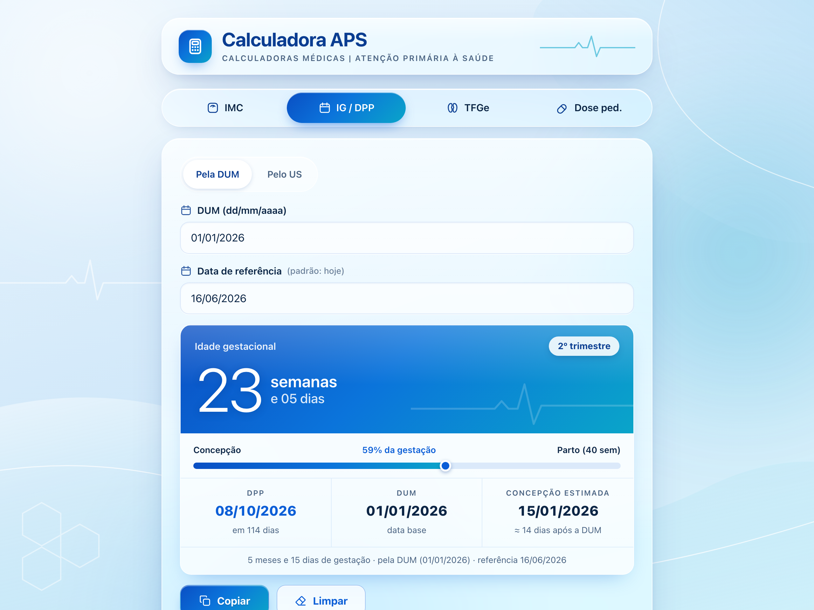
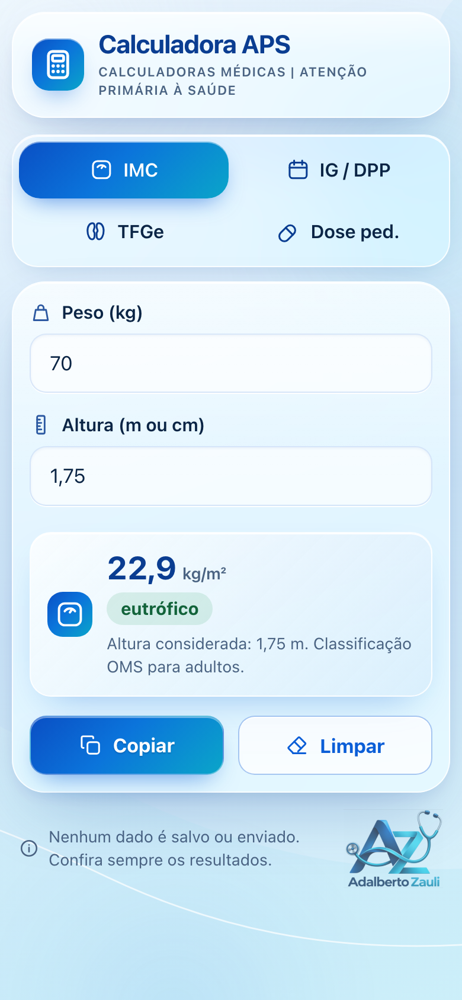
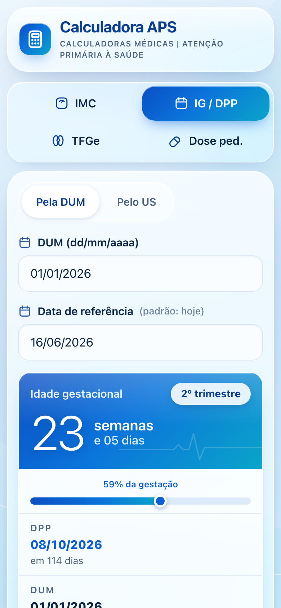
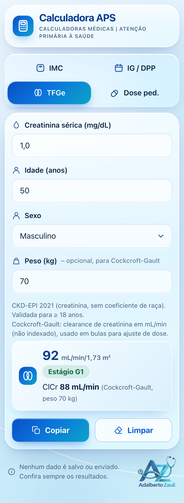
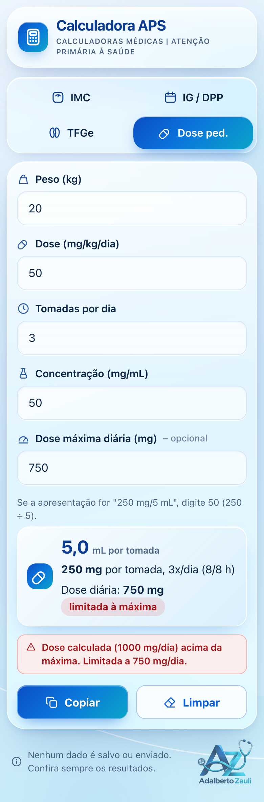
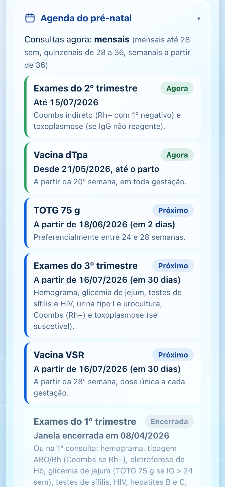
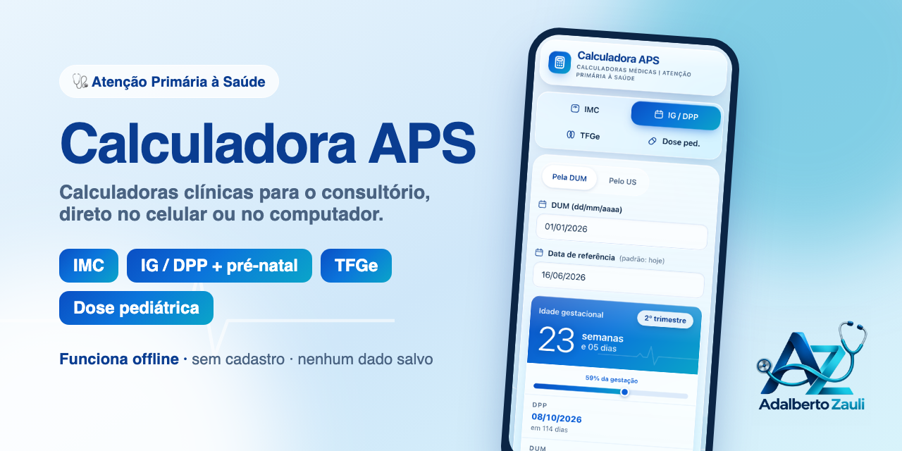

<div align="center">


# Calculadora APS

**Calculadoras clínicas para o consultório da Atenção Primária à Saúde: rápidas, offline e sem cadastro.**

[](https://adalbertozauli.github.io/calculadora-aps/)




</div>

---

## Por que existe

Sou médico de família e precisava de uma calculadora que coubesse **ao lado do prontuário eletrônico**, desse a resposta **enquanto eu digito** e gerasse um **texto pronto para colar** na evolução, sem login, sem anúncios e sem enviar dado de paciente para lugar nenhum.

A Calculadora APS reúne as contas que mais uso no dia a dia da Atenção Primária em uma única página leve, que roda no navegador do computador e do celular, **inclusive sem internet**.

## O que ela faz

<table>
<tr>
<td align="center" width="25%"><br><b>IMC</b></td>
<td align="center" width="25%"><br><b>Idade gestacional e DPP</b></td>
<td align="center" width="25%"><br><b>TFG estimada</b></td>
<td align="center" width="25%"><br><b>Dose pediátrica</b></td>
</tr>
</table>

### 1. IMC
- Peso em kg e altura **em metros ou centímetros** (1,75 ou 175: ela reconhece sozinha).
- Classificação da **OMS para adultos**: baixo peso, eutrófico, sobrepeso e obesidade graus I, II e III, com selo colorido e o nome sempre escrito (não depende só da cor).
- Copia: `IMC 22,9 kg/m² (eutrófico)`

### 2. Idade gestacional e DPP
- Cálculo **pela DUM** ou **pelo ultrassom** (data do exame + IG no exame).
- IG por extenso (`23 semanas e 05 dias`), **trimestre**, **meses de gestação**, **DPP** com contagem regressiva, **concepção estimada** e barra de progresso da gestação.
- **Agenda do pré-natal** com datas calculadas para cada gestante, marcando o que é para **agora**, o que é **próximo** e o que já **encerrou**: exames por trimestre, ultrassonografia, TOTG 75 g, vacinas dTpa e VSR e frequência de consultas, conforme a *Caderneta Brasileira da Gestante* (Ministério da Saúde, 2026).
- Campos de data com **máscara automática** (`01012026` → `01/01/2026`) e **ano abreviado** (`01/01/26` → `01/01/2026`).
- Copia: `IG 23 semanas e 05 dias, 2º trimestre. DPP 08/10/2026.`

<div align="center"></div>

### 3. TFG estimada
- **CKD-EPI 2021** (creatinina, sem coeficiente de raça), com estágio **KDIGO** (G1 a G5).
- Com o peso (opcional), mostra também o **clearance de creatinina por Cockcroft-Gault**, o valor usado nas bulas para ajuste de dose de medicamentos.
- Copia: `TFGe 92 mL/min/1,73 m² (CKD-EPI 2021), estágio G1. ClCr 88 mL/min (Cockcroft-Gault, peso 70 kg)`

### 4. Dose pediátrica por peso
- Peso, dose em mg/kg/dia, número de tomadas, concentração da apresentação e **dose máxima diária** (opcional).
- Mostra dose diária, dose por tomada (mg), **volume por tomada (mL)** e o intervalo (ex.: 8/8 h).
- Se a dose calculada passar da máxima, **limita automaticamente e mostra um alerta vermelho**.
- Copia: `Dose: 20 kg × 50 mg/kg/dia = 1000 mg/dia. 333 mg por tomada, 3x/dia (8/8 h) = 6,7 mL por tomada (apresentação 50 mg/mL).`

### Em todas as abas
| | |
|---|---|
| ⚡ **Resultado em tempo real** | Atualiza a cada tecla, sem botão "calcular". |
| 📋 **Botão Copiar** | Gera o texto pronto para colar no prontuário. |
| 🇧🇷 **Formato brasileiro** | Vírgula decimal (aceita vírgula ou ponto) e datas dd/mm/aaaa. |
| 🛡️ **Validação gentil** | Valores vazios ou absurdos (ex.: altura de 17 m) geram um aviso discreto ao lado do campo, não um erro. |
| ⌨️ **Teclado e acessibilidade** | Navegação por Tab, setas entre abas, foco visível, contraste adequado e respeito à preferência de "menos movimento". |
| 📱 **Responsiva** | Funciona em janela estreita ao lado do prontuário, no celular e no tablet. |

## Como usar

### No computador
Abra **https://adalbertozauli.github.io/calculadora-aps/**, ou baixe o arquivo [`calculadora-aps.html`](calculadora-aps.html) e dê dois cliques. O arquivo é **autossuficiente**: funciona offline e pode ser enviado por e-mail ou pen drive.

### No celular, como um aplicativo
1. Abra o link no **Safari** (iPhone) ou no **Chrome** (Android).
2. iPhone: **Compartilhar → Adicionar à Tela de Início**. Android: **⋮ → Adicionar à tela inicial**.
3. Pronto: o ícone **Calc APS** abre em tela cheia e **funciona sem internet** depois da primeira abertura.

> **iPhone:** abrir o arquivo `.html` pelo app Arquivos ou pelo WhatsApp **não funciona**, porque a pré-visualização do iOS não executa JavaScript. Use o link.

## Privacidade

- **Nenhum dado é salvo nem enviado.** Todas as contas acontecem no próprio aparelho.
- Sem cadastro, sem cookies, sem analytics e sem bibliotecas ou fontes externas.
- A cópia offline guarda apenas os arquivos do site, nunca o que é digitado.

## Como funciona por dentro

```
calculadora-aps/
├── calculadora-aps.html     ← a aplicação inteira (HTML + CSS + JavaScript)
├── index.html               ← página inicial do site (abre a calculadora)
├── sw.js                    ← service worker: modo offline
├── manifest.webmanifest     ← nome, ícone e cores do app no celular
├── icones/                  ← ícones do app
└── docs/img/                ← imagens deste README
```

O `calculadora-aps.html` é organizado em quatro blocos, com o código comentado em português:

1. **`<style>`**: visual "Liquid Glass" construído só com CSS: variáveis de cor e de vidro, `backdrop-filter`, layout responsivo e alternativas para navegadores sem desfoque, modo de alto contraste e preferência por menos movimento.
2. **HTML**: as quatro abas, com ícones SVG desenhados no próprio arquivo e a logomarca embutida em base64.
3. **`<script id="calculos">`**: **só as contas**, em funções puras que não tocam na tela (`calcularIMC`, `igPorDUM`, `calcularTFG`, `calcularDose`, `agendaPreNatal`…). Isso permite testá-las isoladamente.
4. **`<script id="interface">`**: lê os campos, chama as contas, mostra resultado e avisos e cuida de copiar, limpar, máscaras e modo offline.

Algumas decisões técnicas:

- **Datas no fuso local.** Usa `new Date(ano, mês, dia)` e nunca `new Date("2026-01-01")`, que é interpretado em UTC e pode errar um dia no Brasil.
- **JavaScript puro**, sem frameworks nem etapa de build. Abrir o arquivo já é rodar a aplicação.
- **Offline (PWA).** O `sw.js` usa a estratégia *network-first*: com internet, sempre busca a versão mais nova e atualiza a cópia; sem internet, ou com sinal fraco (mais de 4 s), usa a cópia guardada. Atualizações chegam sozinhas aos usuários.
- **Agenda do pré-natal como dados.** As janelas de exames e vacinas ficam numa lista (`JANELAS_PRENATAL`) com a fonte comentada. Atualizar o protocolo é editar a lista, não a lógica.

### Para adicionar uma nova calculadora
1. Crie o botão da aba e o painel no HTML (`painel-xxx`, `res-xxx`, `avisos-xxx`).
2. Escreva a conta no bloco `calculos`.
3. Escreva `atualizarXxx()` no bloco `interface`, usando as outras como modelo.
4. Registre em `CALCULADORAS`. Atualizar enquanto digita, copiar, limpar e avisos já funcionam sozinhos.

## Validação

Casos conferidos antes de cada versão:

| Calculadora | Entrada | Resultado esperado |
|---|---|---|
| IMC | 70 kg, 1,75 m | 22,9 kg/m², eutrófico |
| DPP | DUM 01/01/2026 | 08/10/2026 |
| TFGe | homem, 50 anos, Cr 1,0 mg/dL | 92 mL/min/1,73 m² (G1) |
| TFGe | mulher, 60 anos, Cr 0,6 mg/dL | 103 mL/min/1,73 m² (G1) |
| Cockcroft-Gault | homem, 50 anos, 70 kg, Cr 1,0 | 88 mL/min |
| Dose | 20 kg, 50 mg/kg/dia, 3 tomadas, 50 mg/mL | 1000 mg/dia; 333 mg e 6,7 mL por tomada |
| Trimestre | 13s6d / 14s0d / 27s6d / 28s0d | 1º / 2º / 2º / 3º |

## Referências

- **IMC:** World Health Organization. *Obesity: preventing and managing the global epidemic.* WHO Technical Report Series 894, 2000.
- **CKD-EPI 2021:** Inker LA et al. *New Creatinine- and Cystatin C–Based Equations to Estimate GFR without Race.* N Engl J Med 2021;385:1737-49.
- **Estágios da DRC:** KDIGO 2024 Clinical Practice Guideline for the Evaluation and Management of CKD.
- **Cockcroft-Gault:** Cockcroft DW, Gault MH. *Prediction of creatinine clearance from serum creatinine.* Nephron 1976;16:31-41.
- **Pré-natal:** Brasil. Ministério da Saúde. [*Caderneta Brasileira da Gestante*](https://www.gov.br/saude/pt-br/assuntos/saude-de-a-a-z/s/saude-da-mulher/publicacoes/caderneta-brasileira-da-gestante.pdf). Brasília: MS/SAPS, 2026 (p. 34–42).
- **DPP:** regra de Naegele (DUM + 280 dias).

## Aviso

Ferramenta de **apoio** à decisão clínica. **Não substitui o julgamento do profissional de saúde.** Confira sempre os resultados antes de registrar ou prescrever.

---

<div align="center">



Desenvolvido por **Adalberto Zauli**, médico de família e comunidade.

</div>
